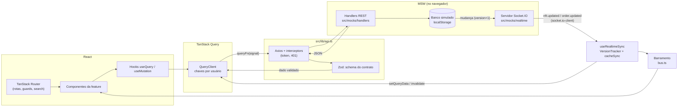
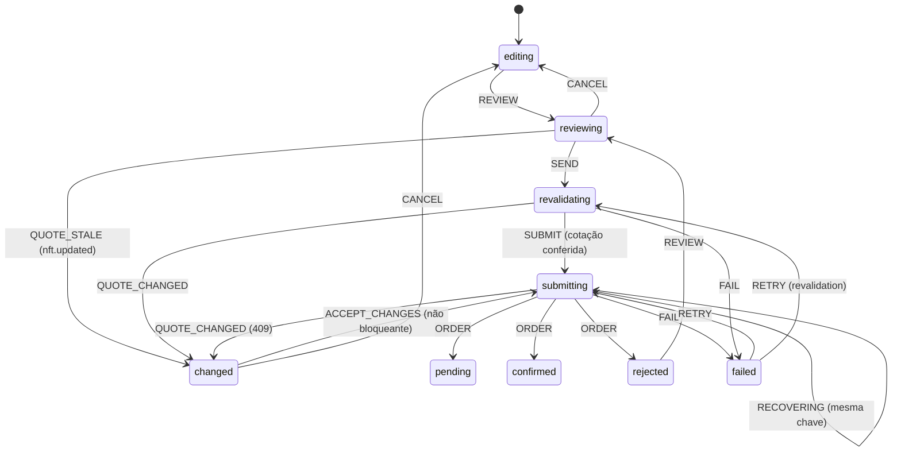

# Arquitetura

Este documento descreve como o Kurio (marketplace de NFTs) está organizado e por quê. Cada seção aponta para os arquivos que implementam o que está descrito. Para contratos da API, eventos em tempo real e cenários de simulação, veja também [docs/API.md](docs/API.md), [docs/REALTIME.md](docs/REALTIME.md) e [docs/SCENARIOS.md](docs/SCENARIOS.md).

## Sumário

1. [Visão geral e organização por feature](#1-visão-geral-e-organização-por-feature)
2. [Fluxo de dados](#2-fluxo-de-dados)
3. [Política de sessão](#3-política-de-sessão)
4. [Estado do carrinho](#4-estado-do-carrinho)
5. [Cache, retries e sincronização](#5-cache-retries-e-sincronização)
6. [Reconciliação REST e Socket.IO](#6-reconciliação-rest-e-socketio)
7. [Checkout e pedidos](#7-checkout-e-pedidos)
8. [Mocking](#8-mocking)
9. [Decisões de UX](#9-decisões-de-ux)
10. [Desvios do Figma](#10-desvios-do-figma)
11. [Ajustes de acessibilidade em relação ao layout](#11-ajustes-de-acessibilidade-em-relação-ao-layout)
12. [Limitações conhecidas](#12-limitações-conhecidas)
13. [Mapa dos testes](#13-mapa-dos-testes)
14. [Substituições de assets](#substituições-de-assets)

---

## 1. Visão geral e organização por feature

SPA em Vite + React 19 + TypeScript. Usa TanStack Router (rotas por arquivo) e TanStack Query (estado do servidor), Axios para REST, socket.io-client para tempo real, Zod para contratos, decimal.js para valores em ETH, Tailwind e shadcn/ui para a interface. A API e o servidor Socket.IO são simulados por MSW dentro do navegador. Não existe backend real (ver [§8](#8-mocking)).

| Pasta | Conteúdo |
| --- | --- |
| [src/contracts/](src/contracts/) | Schemas Zod de toda resposta, corpo de requisição e evento em tempo real. É a fonte única dos tipos. |
| [src/lib/](src/lib/) | Infraestrutura sem regra de tela: cliente Axios ([api.ts](src/lib/api.ts)), `QueryClient` ([queryClient.ts](src/lib/queryClient.ts)), fábrica de chaves ([queryKeys.ts](src/lib/queryKeys.ts)), storage privado por usuário ([privateStorage.ts](src/lib/privateStorage.ts)), formatação de ETH ([eth.ts](src/lib/eth.ts)) e o aviso de recurso indisponível ([unavailable.ts](src/lib/unavailable.ts)). |
| [src/features/](src/features/) | Uma pasta por domínio: `auth`, `catalog`, `cart`, `checkout`, `orders`, `favorites`, `profile`, `wallets`, `account` (layout e guarda de saída da área da conta), `home` e `realtime`. Cada uma traz a própria API (`*Api.ts`), hooks do Query e componentes, e expõe a interface pública em `index.ts`. |
| [src/routes/](src/routes/) | Rotas do TanStack Router. São finas: validam o search, rodam guards e montam o componente da feature. As rotas privadas ficam sob o layout sem caminho [_authenticated.tsx](src/routes/_authenticated.tsx). |
| [src/components/](src/components/) | Layout (header, footer, navegação mobile, [Shell.tsx](src/components/layout/Shell.tsx)), componentes compartilhados (`ComingSoon`, `NftCarousel`, `FormField`) e os primitivos do shadcn em `ui/`. |
| [src/mocks/](src/mocks/) | Toda a simulação: banco, handlers REST, servidor Socket.IO, cenários e painel `window.__mocks`. É o único lugar com dado fictício. |
| [e2e/](e2e/) | Testes Playwright e baselines visuais. |

O ponto de entrada é [src/main.tsx](src/main.tsx). Ele liga o MSW (quando `VITE_ENABLE_MOCKS === 'true'`), espera o worker subir e só então renderiza `QueryClientProvider > AuthProvider > RouterProvider`. Se o MSW falhar, a página mostra o motivo em vez de seguir sem API.

## 2. Fluxo de dados

- **Router.** [src/router.ts](src/router.ts) cria o router com `context: { queryClient, session }`, `defaultPreload: 'intent'` e `defaultPreloadStaleTime: 0`. O Query decide a frescura dos dados; o Router não guarda cópia própria. Os parâmetros de busca são serializados por [src/lib/searchParams.ts](src/lib/searchParams.ts), e os filtros do catálogo moram na URL ([features/catalog/searchParams.ts](src/features/catalog/searchParams.ts)).
- **Query.** Os componentes leem dados só por hooks (`useNft`, `useCatalogQuery`, `useCart`, `useOrderStatus`...). Toda `queryFn` repassa o `signal` do Query ao Axios.
- **Axios + Zod.** Em [src/lib/api.ts](src/lib/api.ts), `api.get/post/put/patch/delete` recebem um schema de [src/contracts](src/contracts/) e validam a resposta com `safeParse`. Se a resposta sair do contrato, vira `ApiRequestError` com `kind: 'contract'`. Todo erro é normalizado para `ApiRequestError` (`kind` `http`, `network` ou `contract`; `code` do contrato `ApiError`; getter `transient`). O cancelamento por `AbortSignal` passa adiante sem conversão, para o Query reconhecê-lo. O interceptor de requisição injeta `Authorization: Bearer <token>`, e o de resposta trata o 401 (ver [§3](#3-política-de-sessão)).
- **MSW.** Intercepta `/api/*` no service worker e responde a partir do banco simulado. Rotas desconhecidas devolvem 404 no formato `ApiError` ([handlers/index.ts](src/mocks/handlers/index.ts)).

## 3. Política de sessão

A sessão vive fora do React em [src/features/auth/session.ts](src/features/auth/session.ts) (`sessionStore`, com os estados `loading`, `anonymous` e `authenticated`). Assim, o Axios (token e 401) e os `beforeLoad` do Router leem o mesmo estado. O [AuthProvider](src/features/auth/AuthProvider.tsx) apenas o expõe via `useSyncExternalStore`.

**Restauração após refresh.** O token opaco fica em `localStorage` ([tokenStorage.ts](src/features/auth/tokenStorage.ts)). Ao montar, o `AuthProvider` chama `sessionStore.restore()`, que valida o token em `GET /auth/session` (com `skipAuthRedirect`, para esse 401 não disparar o fluxo global). O resultado depende da resposta:
- 401: a sessão é encerrada e o token apagado.
- Outra falha (rede, 5xx): o app segue anônimo, mas mantém o token para a próxima tentativa.

O evento `storage` restaura de novo quando o token muda em outra aba. Os guards [requireSession e redirectIfAuthenticated](src/features/auth/routeGuards.ts) aguardam `whenReady()` antes de decidir, então um refresh numa rota privada não pisca o login.

**401 durante o uso.** O interceptor de [api.ts](src/lib/api.ts) só reage se o `Authorization` enviado é o token atual. Um 401 de um token antigo ou de um login com senha errada é ignorado. Nesse caso, [router.ts](src/router.ts) chama `sessionStore.expire()` e navega para `/login?redirect=<rota atual>&reason=expired` com `replace`. A tela de login ([AuthScreen.tsx](src/features/auth/components/AuthScreen.tsx)) mostra "Sua sessão expirou..." e tira o `reason` da URL, para o aviso não reaparecer num refresh ou num link compartilhado. O destino de volta passa por [safeRedirect](src/features/auth/redirect.ts), que aceita só caminhos internos e nunca `/login` ou `/signup`.

**Limpeza.** `discardSessionData()` cancela as queries, faz `queryClient.clear()` e fecha o socket (`closeSocket()` remove todos os listeners da sessão).
- **Logout:** chama `POST /auth/logout`, que é tolerante a falha. Depois apaga com `clearUserPrivateData(userId)` todas as chaves `nft-marketplace:…:<userId>` de `localStorage` e `sessionStorage`: rascunho do checkout, tentativa de pedido e pedido pendente. Em seguida apaga o token, limpa o cache, fecha o socket e invalida o carrinho, que passa a ser o de visitante.
- **Troca de usuário sem logout:** `applySession` detecta o id diferente, descarta cache e socket e apaga os dados privados do anterior. `clearOtherUsersPrivateData` cobre também a troca depois de um 401 ou de um refresh, quando não há "usuário anterior" em memória.
- **Regravação bloqueada:** [privateStorage.ts](src/lib/privateStorage.ts) mantém o conjunto `erased`. Enquanto o usuário apagado não entrar de novo, um efeito ainda montado (formulário, reenvio em andamento) não consegue regravar o que foi apagado.
- **Guards:** a cada mudança de identidade, [router.ts](src/router.ts) chama `router.invalidate()`, e os guards rodam de novo na rota atual.

**O que sobrevive à expiração.** `expire` é o mesmo `endSession` do logout, mas **sem** `clearUserPrivateData`. Rascunho do formulário (`sessionStorage`), tentativa de pedido com chave de idempotência e pedido pendente (`localStorage`) continuam lá. Assim, o mesmo usuário volta ao `/checkout` depois do login e retoma sem duplicar o pedido (ver [§7](#7-checkout-e-pedidos)). O cache do Query e o socket são descartados mesmo assim.

## 4. Estado do carrinho

- **Dono.** [useCartOwner](src/features/cart/useCart.ts) devolve `{ userId }` para quem está logado, `{ guestId }` para visitantes e `null` enquanto a sessão está em `loading`. Com `null`, nenhuma query ou mutation roda. O `guestId` é um UUID gerado no cliente e guardado em `localStorage` ([guestId.ts](src/features/cart/guestId.ts)), enviado em `X-Guest-Cart-Id` ([cartApi.ts](src/features/cart/cartApi.ts)). A chave do cache inclui o dono (`['cart', owner]`), então carrinhos de donos diferentes nunca se misturam.
- **O carrinho guarda só ids e quantidades** ([contracts/cart.ts](src/contracts/cart.ts)). Os dados do NFT de cada linha vêm de [useCartLines](src/features/cart/useCartLines.ts), que reaproveita a chave do detalhe (`['nfts', 'detail', id]`).
- **A cotação é a fonte dos valores.** [useQuote](src/features/cart/useQuote.ts) faz `POST /quote` com itens e cupom. A chave inclui dono, itens e cupom. Preço unitário, total da linha, subtotal, desconto, taxa de rede e total exibidos vêm da cotação, nunca de contas na tela. Enquanto a nova cotação não chega, a anterior fica como `placeholderData`, desde que seja do mesmo dono. [CartPage](src/features/cart/components/CartPage.tsx) bloqueia "Conectar e finalizar" quando a cotação falhou, está atualizando, tem item `unavailable` ou cupom recusado. O cupom só é gravado no carrinho depois que uma cotação o aceita ([useCoupon.ts](src/features/cart/useCoupon.ts)).
- **Mescla ao autenticar.** Login e cadastro enviam `X-Guest-Cart-Id` ([authApi.ts](src/features/auth/authApi.ts)). O servidor simulado soma as quantidades ao carrinho do usuário, respeitando `maxPerOrder`, adota o cupom do visitante se o usuário não tem um e apaga o carrinho de visitante (`mergeGuestCart` em [store.ts](src/mocks/db/store.ts)). No cliente, `applySession` invalida `['cart']` para buscar o carrinho mesclado.
- **Reação a `nft.updated`.** [cacheSync.applyNftUpdate](src/features/realtime/cacheSync.ts) atualiza o NFT no detalhe, nas listas e nos favoritos, e invalida as cotações dos carrinhos em cache que contêm o NFT. [useCartRealtime](src/features/cart/useCartRealtime.ts) assina o barramento e gera avisos em texto por item: preço subiu ou caiu, disponibilidade reduzida. Só no `/cart` (`adjustQuantities: true`), ele também ajusta para o máximo disponível uma quantidade acima do novo estoque. No checkout, a revisão é marcada como desatualizada (ver [§7](#7-checkout-e-pedidos)). Avisos da cotação já cobertos por um aviso em tempo real não aparecem duas vezes (`visibleWarnings`).

## 5. Cache, retries e sincronização

**Padrões** ([queryClient.ts](src/lib/queryClient.ts)):
- `staleTime` de 30 s: a navegação entre telas reaproveita o cache. Tempo real e invalidação após mutations cuidam da frescura no restante.
- `gcTime` padrão de 5 min.
- Retry de query só quando `ApiRequestError.transient` (rede ou `code: 'transient'`), no máximo 2 novas tentativas, com backoff `min(500·2^n, 4000)` ms. 4xx e respostas fora do contrato nunca são repetidas.
- **Mutations nunca repetem** (`retry: false`), porque um reenvio automático pode duplicar efeitos. O checkout tem recuperação própria, com a mesma chave de idempotência.

**Chaves** ([queryKeys.ts](src/lib/queryKeys.ts)):
- Dados públicos: `['nfts', 'list', query]` e `['nfts', 'detail', id]`.
- Dados privados começam com `['user', userId, ...]` (perfil, favoritos, carteiras, pedidos). O cache fica isolado por usuário, e o cache inteiro é limpo no logout e na troca de usuário.
- O carrinho é `['cart', owner]`, e a cotação é `['cart', owner, 'quote', request]`.

**Por tela:**
- Catálogo ([useCatalogQuery.ts](src/features/catalog/list/useCatalogQuery.ts)): a chave tem todos os filtros. `placeholderData: keepPreviousData` mantém a página anterior enquanto a nova carrega, e uma resposta atrasada cai na própria chave e nunca sobrescreve a atual. O `AbortSignal` cancela a requisição abandonada. Há uma única nova tentativa, de 500 ms, para o "Tentar de novo" aparecer logo.
- Pedido ([useOrderStatus.ts](src/features/orders/useOrderStatus.ts)): `staleTime: 0`, `refetchOnWindowFocus` e `refetchOnReconnect` com `'always'`.
- Envio do pedido: timeout de 10 s, menor que os 15 s do Axios, para a recuperação começar logo ([checkoutApi.ts](src/features/checkout/checkoutApi.ts)).

**Atualização otimista com rollback:**
- **Favoritos** ([useFavorites.ts](src/features/favorites/useFavorites.ts)): `onMutate` cancela a query e aplica o favorito. Em erro, desfaz **só aquele NFT**, sem desfazer outras mutations em voo, e mostra um toast. `onSettled` invalida. Enquanto a mutation do próprio NFT roda, o coração fica ocupado (`useMutationState`). Visitante é mandado ao login com `redirect`.
- **Carrinho** ([useCartItemMutations.ts](src/features/cart/useCartItemMutations.ts)): a quantidade é otimista, e o rollback volta só a quantidade daquele item. Um 409 (estoque) invalida o detalhe do NFT. O carrinho só é relido quando a **última** mutation de item termina (`isMutating <= 1`), para não apagar o otimismo de outra linha. A remoção não é otimista: a linha some quando a API confirma.
- **Perfil** ([useProfile.ts](src/features/profile/useProfile.ts)): o avatar mostra a prévia na hora, também no header via `sessionStore.updateUser`, e em erro volta ao anterior. Os outros campos são salvos sem otimismo. Em seguida o app atualiza cache e sessão e invalida carteiras e a sessão.

## 6. Reconciliação REST e Socket.IO

**Conexão** ([socket.ts](src/features/realtime/socket.ts)): há uma conexão por sessão. Visitante conecta sem token e recebe só `nft.updated`; autenticado recebe também `order.updated`. Duas regras de implementação:
- O `socket.io-client` é importado sob demanda, porque o `engine.io-client` captura o `WebSocket` global ao ser avaliado e o MSW só o substitui em `enableMocking()`.
- O `auth` é uma função, para o token ser lido de novo a cada reconexão.

O status da conexão (`idle`, `connecting`, `connected`, `reconnecting`, `disconnected`) alimenta o [ConnectionIndicator](src/features/realtime/ConnectionIndicator.tsx), que fica quieto enquanto está conectado e anuncia a queda, a tentativa de reconexão e a volta.

**Recepção** ([useRealtimeSync.ts](src/features/realtime/useRealtimeSync.ts), montado uma vez em [__root.tsx](src/routes/__root.tsx)), para cada evento:
1. Valida com o contrato ([contracts/events.ts](src/contracts/events.ts)). Evento inválido é descartado.
2. Confere que ainda é a mesma sessão. Em `order.updated`, confere também que `event.userId` é o usuário atual.
3. Passa pelo [VersionTracker](src/features/realtime/versions.ts), um `Map` recurso → última version e ids vistos, limitado a 500 recursos e 20 ids por recurso. O evento é descartado como `duplicate` (id já visto) ou `stale` (version menor ou igual à conhecida **ou** à do dado em cache).
4. Se aceito, aplica ao cache em [cacheSync.ts](src/features/realtime/cacheSync.ts), sempre com `setQueryData` e sem refazer listas, e cada cópia só avança se for mais antiga (`patchNft`). Depois publica no [barramento](src/features/realtime/bus.ts).

**Barramento.** As telas nunca assinam o socket direto: usam `onSyncedEvent`, que só entrega eventos já aceitos e aplicados, junto com o dado **anterior** em cache. Assim, avisos, anúncios e diálogos rodam no máximo uma vez por mudança. Exemplos: [useCartRealtime](src/features/cart/useCartRealtime.ts), [useStaleQuoteGuard](src/features/checkout/useStaleQuoteGuard.ts), [useNftChangeAnnouncer](src/features/catalog/detail/useNftChangeAnnouncer.ts) e [useOrderStatus](src/features/orders/useOrderStatus.ts).

**Reconexão.** No `connect` que segue uma queda, o tracker é zerado e `reconcileWithApi` invalida catálogo, carrinhos e, com sessão, pedidos e favoritos. Só as queries ativas são refeitas; o resto relê quando voltar à tela. Um evento antigo que chegue depois continua descartado pela version do cache.

**Pedido pendente sem socket.** Em [useOrderStatus](src/features/orders/useOrderStatus.ts), o pedido pendente é relido a cada `ORDER_POLL_MS` (5 s) **enquanto o socket não está `connected`**. Ao conectar com o pedido pendente, o app relê uma vez. O polling também para com 403/404 e em estado terminal.

**Estados terminais.** `confirmed` e `rejected` são terminais (`isTerminalOrderStatus` em [contracts/order.ts](src/contracts/order.ts)). `applyOrderUpdate` nunca regride um pedido terminal nem aplica version menor ou igual. Os efeitos do estado terminal ficam em [settleTerminalOrder](src/features/orders/settleOrder.ts): esquecer o pedido pendente e a chave de idempotência (só se forem desse pedido) e invalidar carrinho, catálogo e lista de pedidos. Eles rodam uma vez:
- com a tela do pedido aberta, por `useOrderStatus`, com uma marca `id:status`;
- sem tela observando, pelo próprio `cacheSync`.

## 7. Checkout e pedidos

**Máquina de estados** ([machine.ts](src/features/checkout/machine.ts), reducer puro usado por [useCheckoutFlow.ts](src/features/checkout/useCheckoutFlow.ts)):

- O pedido só sai de `submitting`. Chega-se lá só por `revalidating` (cotação conferida) ou por `changed` com nova confirmação do usuário.
- Eventos fora da tabela são ignorados: um clique atrasado não pula etapas.
- Além do botão desabilitado pelo estado, uma ref `inFlight` barra o clique repetido no mesmo frame.
- Um `FAIL` de validação volta para `editing`, com os erros nos campos.

**Revalidação da cotação.**
- **Antes do POST:** "Enviar pedido" refaz `POST /quote` e compara com a cotação revisada usando decimal.js ([quoteChanges.diffQuotes](src/features/checkout/quoteChanges.ts)): preço e quantidade por item, itens que entraram ou saíram, disponibilidade, cupom, subtotal, desconto, taxa e total. Qualquer diferença abre o diálogo de mudanças com antes e depois em texto. Um item `unavailable` torna a mudança bloqueante.
- **Durante a revisão:** um `nft.updated` de item do pedido com a revisão aberta dispara `QUOTE_STALE` ([useStaleQuoteGuard.ts](src/features/checkout/useStaleQuoteGuard.ts)). O envio fica bloqueado até a nova cotação chegar e o usuário confirmar de novo.
- **Na resposta da API:** o 409 de `POST /orders` ([OrderConflict](src/contracts/order.ts): `price_changed` com a cotação nova, `sold_out` ou `insufficient_stock`) e a cotação vencida levam ao mesmo diálogo.

**Idempotência** ([idempotency.ts](src/features/checkout/idempotency.ts), [storage.ts](src/features/checkout/storage.ts)):
- A chave é um UUID enviado no cabeçalho `Idempotency-Key` e no corpo.
- A tentativa guardada em `localStorage` tem `key`, `hash` do conteúdo e `input`. O hash (cyrb53 de JSON com chaves ordenadas) cobre itens, quantidades, cupom, carteira e valores normalizados da cotação, **sem o id da cotação**: revalidar sem mudança de valores mantém a chave.
- Mesmo conteúdo reaproveita a chave. Conteúdo diferente, já confirmado pelo usuário, ou chave recusada (409 de idempotência) geram chave nova.
- A tentativa é gravada como `uncertain: true` **antes** do envio. Em timeout ou queda, o app reenvia o mesmo corpo com a mesma chave até 5 vezes, com backoff de 1 s a 8 s ("Verificando seu pedido..."). Se ainda não houver resposta, o erro `unverified` oferece "Tentar de novo" com a mesma chave.
- Ao abrir `/checkout` com uma tentativa incerta (refresh, queda ou novo login após 401), a verificação recomeça sozinha.
- [resolvePendingOrder](src/features/checkout/pendingOrder.ts) manda para o pedido pendente guardado em vez de permitir um novo envio.

**Pedido e recibo.**
- `POST /orders` devolve o pedido `pending`. O app guarda o id como pendente e navega para `/orders/$id`, onde [useOrderStatus](src/features/orders/useOrderStatus.ts) é a única fonte de verdade. Um pedido `rejected` fica no checkout, com carrinho e formulário intactos e o motivo da API.
- O recibo ([ReceiptView.tsx](src/features/orders/components/ReceiptView.tsx)) só é renderizado para pedido `confirmed` e usa **apenas** o `snapshot` imutável do pedido (itens, preços, cupom, totais, carteira, rede, comprador), nunca o catálogo atual. Mudar o preço do NFT depois da compra não altera o recibo.
- 403 e 404 de um pedido têm o mesmo tratamento, para a tela não revelar se o pedido existe.

## 8. Mocking

Tudo em [src/mocks/](src/mocks/). O app não importa nada daqui além do `enableMocking` dinâmico de [main.tsx](src/main.tsx).

- **Banco com persistência** ([db/store.ts](src/mocks/db/store.ts)): estado em memória, gravado em `localStorage` (`nft-marketplace:mocks:db`). Toda escrita passa por `transact`, que aplica num clone, persiste e só então publica os eventos de mudança. Cada mudança de NFT ou pedido incrementa `version`, a mesma que o REST devolve e o evento carrega. Pedidos pendentes são liquidados por timer (`orderSettleMs`, padrão 2,5 s) e reagendados após um refresh. Uma carteira terminada em `dead` faz o pagamento ser recusado. O evento `storage` mantém as abas com o mesmo banco.
- **Versão do esquema:** `SCHEMA_VERSION` ([db/seed.ts](src/mocks/db/seed.ts), hoje 5). Um estado salvo com outra versão é ignorado e o seed é recriado.
- **Reset:** `window.__mocks.reset()` restaura exatamente o seed, as configurações padrão ([settings.ts](src/mocks/settings.ts)) e o cenário `default`, e fecha as conexões do socket e o histórico de eventos.
- **Cenários determinísticos** ([scenarios/](src/mocks/scenarios/), documentados em [docs/SCENARIOS.md](docs/SCENARIOS.md)): `default`, `empty`, `slow`, `jitter`, `offline`, `server-error`, `client-errors`, `session-expired`, `register-conflict`, `coupon-invalid`, `coupon-expired`, `price-changed`, `sold-out`, `order-timeout`, `payment-confirmed`, `payment-rejected` e `wallet-rejected`.
  - São escolhidos por `?scenario=nome&seed=n`, pelo `localStorage` ou por `setScenario`.
  - Todo handler passa por `route` → `withScenario` ([handlers/utils.ts](src/mocks/handlers/utils.ts)), que aplica latência, gatilhos antes e depois do handler e falhas injetadas por `failNext`.
  - A latência do `jitter` deriva da seed e da ordem da requisição, então "fora de ordem" é reproduzível. Contadores e gatilhos ficam no `runtime`, persistido.
- **Painel de controle:** `window.__mocks` ([control.ts](src/mocks/control.ts)) oferece `configure`, `failNext`, `expireSessions`, `setNftPrice`, `setEditionAvailable`, os controles de tempo real e `inspectQueryCache`, este só de leitura e usado pelos testes de isolamento.
- **Socket.IO simulado** ([realtime/socket.ts](src/mocks/realtime/socket.ts)): um handler `ws` do MSW em `/socket.io/`, com Engine.IO v4 e transporte websocket. O handshake é feito à mão: o `CONNECT` valida `auth.token` e um token inválido ou vencido recebe `CONNECT_ERROR`. A codificação dos pacotes de evento usa `toSocketIo` de `@mswjs/socket.io-binding`. Salas: `public` para `nft.updated` e `user:<id>` para `order.updated`. Os controles `emitNftUpdate`, `emitOrderUpdate`, `emitDuplicate`, `emitStale`, `disconnectSockets`, `reconnectSockets`, `updateNftSilently`, `settleOrderSilently`, `socketStats` e `probe` estão em [docs/REALTIME.md](docs/REALTIME.md).
- **Limitações do transporte:** ver [§12](#12-limitações-conhecidas).

## 9. Decisões de UX

Resumo de [docs/design/screens.md](docs/design/screens.md), conferido no código:

- **Fora do escopo, visível mas sem fingir sucesso.** Os itens fora do escopo usam [ComingSoon](src/components/ComingSoon.tsx), um link ou botão com `aria-disabled="true"`. Ele continua focável, não navega e mostra o toast "Indisponível nesta versão" ([unavailable.ts](src/lib/unavailable.ts)), com id fixo para não empilhar toasts. Vale para Criadores, Aprenda, "Ler mais" do Diário da Cunhagem, newsletter, links de ajuda do rodapé, Google/Facebook, "Esqueceu a senha?", scan central do mobile, Atividade, Ofertas, Arquivos baixados, Suporte, compartilhar e a aba Avaliações (que mostra só a nota agregada). "Ver no Etherscan" abre a referência simulada e avisa "Referência simulada, não é uma transação real." O coração do mobile e "Lista de interesse" levam a `/favorites` ([content.ts](src/components/layout/content.ts)).
- **Carteiras: duas vagas, principal e secundária** (`WALLET_ROLES` em [contracts/wallet.ts](src/contracts/wallet.ts)). "Igual à carteira principal" ([SecondaryWalletSection.tsx](src/features/wallets/components/SecondaryWalletSection.tsx)) é um **gatilho de cópia**, não um vínculo: abre o formulário da secundária com os dados da principal e anuncia que o endereço precisa ser trocado, porque não pode repetir o da principal.
- **Login e cadastro:** modal sobre a Início no desktop, página cheia no mobile. No modal, Esc, clique fora ou o botão de fechar **voltam para a página inicial** ([AuthScreen.tsx](src/features/auth/components/AuthScreen.tsx)). O redirect é preservado entre as abas Entrar e Criar conta.
- **Pagamento:**
  - No mobile, o formulário do colecionador é uma seção recolhível "Dados do colecionador", pré-preenchida com o perfil e a carteira principal. Ela abre sozinha quando há erro.
  - "Carteira e rede" fica sincronizada com "Tipo de carteira", e escolher uma carteira cadastrada preenche endereço, rede e tipo.
  - "Usar outra carteira?" torna obrigatório o campo ENS ou carteira secundária.
  - No Nome ENS o sufixo `.eth` é fixo.
  - "Confirmar compra" só habilita com formulário válido, carteira conectada e cotação válida, e o motivo aparece abaixo do botão.
- **Confirmação:** modal no desktop e página no mobile, só para pedido confirmado. Fechar leva à Início.
- **Saída com mudanças não salvas** na área da conta: diálogo de confirmação ([exitGuard.ts](src/features/account/exitGuard.ts)).
- **Logado:** o cabeçalho mostra avatar e nome com menu e "Sair", não "Entrar".

## 10. Desvios do Figma

### Inconsistências do próprio Figma (decisões de [screens.md](docs/design/screens.md))

1. O subtotal do carrinho mobile (8.92) não bate com a soma dos itens (8.14): usa-se o valor calculado pela cotação.
2. O ID do token difere entre carrinho e pagamento: usa-se o número do nome (#314 → #0314).
3. Os chips de edição do mobile repetem "1/10": usa-se 1/1, 1/10, 1/50, ABERTA, como no desktop.
4. Um card da Home desktop está sem nome e preço: todo card tem os dois.
5. "Ordenar por" sobrepõe o ícone da seta: corrigido.
6. As contagens dos filtros não batem entre si: são calculadas pela API (facetas).
7. A primeira opção de carteira do pagamento desktop é só uma pílula de logos: usam-se as 3 opções do mobile.
8. Código de indicação e Nome ENS estão marcados como obrigatórios: segue-se o layout.
9. O cabeçalho mostra "Entrar" mesmo logado: logado, mostra avatar e nome com menu.
10. O separador decimal varia ("0,02 - 12,30" e "1.19"): ponto em tudo.
11. A avaliação aparece em dois formatos: mostram-se nota e contagem.

### Diferenças confirmadas comparando [docs/design/](docs/design/) com o app

A comparação foi feita com as capturas do próprio app em [e2e/__screenshots__/](e2e/__screenshots__/) (1440 e 390 px):

| Onde | Figma | App | Motivo |
| --- | --- | --- | --- |
| Filtros (desktop e Sheet) | Lista de texto com contagem | Cada opção com **checkbox** ([FilterPanel.tsx](src/features/catalog/list/FilterPanel.tsx)) | Estado selecionado visível e acessível (não só cor); ver [§11](#11-ajustes-de-acessibilidade-em-relação-ao-layout) |
| Rede no filtro | Ethereum, Polygon, **Solana** | Ethereum, Polygon, **Base** | O contrato só aceita `ethereum`, `polygon` e `base` (`NETWORKS` em [wallet.ts](src/contracts/wallet.ts)) |
| Contagens dos filtros | 33, 12, 65... | Calculadas pelo seed (3, 2, 3...) | Inconsistência 6 |
| Ações do card | Coração no mobile; carrinho, favorito e ver no hover do desktop | No mobile e em ponteiro grosso, **as três ações ficam sempre visíveis** (`max-md:opacity-100 pointer-coarse:opacity-100` em [NftCard.tsx](src/features/catalog/list/NftCard.tsx)); no desktop aparecem no hover e no foco | Sem hover em toque, as ações ficariam inalcançáveis |
| Busca no mobile | "Explorar coleções" + filtros **acima** do hero | **Abaixo** do hero, junto das abas e da ordenação | Escolha de implementação, não alinhada ao frame |
| Grid mobile | Duas colunas em zigue-zague (a direita deslocada) | Grid regular de 2 colunas | Ordem de leitura e de foco igual à visual |
| Topo do catálogo | Sem ordenação no mobile e sem total | Seletor "Ordenar por" também no mobile e a linha "36 NFTs" | A ordenação faz parte do escopo nos dois tamanhos; o total dá contexto à paginação |
| Hero mobile | Imagem com miniatura sobreposta | Uma imagem só | Simplificação |
| Nome no card mobile | Sem nome longo no frame | Nome longo truncado com reticências ("Golden Frequency #0...") | Mantém a altura dos cards |
| Rodapé, redes sociais | Ícones | **Texto** abreviado: f, ig, x, in, yt ([content.ts](src/components/layout/content.ts)) | Não há ícones de marca no lucide-react nem assets no Figma |
| Rodapé, coluna Coleções | Inclui "Utilidade" | Só Arte digital, Fotografia, Música e Arte 3D | Lista fixa em `footerCollections` |
| Rodapé, tipografia | Texto maior | Texto um pouco menor | Ajuste fino não feito |
| Imagem do Violet Nomad #314 | Macaco de chapéu (Sage) | Imagem do Emerald Ape | Imagem definida no seed |
| Detalhe mobile | Galeria, chips, Qtd., preço e botões | Acrescenta o botão de zoom, o badge RARO, "Limite de N unidade(s)", "Edição X: N disponível" e o bloco de detalhes (rede, criador, coleção, atributos) e "Mais desta coleção" | Estados de estoque e limite exigidos pela especificação; o zoom é o dialog descrito em screens.md |
| Hero desktop | Carrossel com o Emerald Ape | Carrossel com outra imagem inicial e pontos de página | Conteúdo do carrossel |

## 11. Ajustes de acessibilidade em relação ao layout

O Figma não desenha estes elementos. Eles foram acrescentados sem mudar a composição:

- **Link "Ir para o conteúdo"**, visível só no foco, que leva o foco ao `<main>` ([Shell.tsx](src/components/layout/Shell.tsx)).
- **Um `h1` por página.** Onde o layout não tem título visível (carrinho e login no desktop), o `h1` é `sr-only`. O `<title>` de cada página é distinto ([useDocumentTitle.ts](src/lib/useDocumentTitle.ts)).
- **Checkboxes nos filtros**, dentro de `role="group"` com o título do grupo como nome. Abas com `role="tab"` e `aria-selected`; a paginação marca a página atual com `aria-current`.
- **Estados que não dependem só de cor:**
  - edição esgotada mostra o texto "Esgotada" e o radio fica desabilitado ([EditionPicker.tsx](src/features/catalog/detail/EditionPicker.tsx));
  - mudanças de preço ou estoque aparecem em texto, com antes e depois;
  - favorito e miniaturas da galeria usam `aria-pressed`.
- **Ações do card sempre visíveis no toque** (ver [§10](#10-desvios-do-figma)) e visíveis também no foco do teclado (`group-focus-within`), não só no hover.
- **Regiões `aria-live` sempre montadas.** Toasts (sonner), [QuoteNotices](src/features/cart/components/QuoteNotices.tsx), [ConnectionIndicator](src/features/realtime/ConnectionIndicator.tsx) e o anúncio de mudança no detalhe ([useNftChangeAnnouncer.ts](src/features/catalog/detail/useNftChangeAnnouncer.ts)) ficam vazios no carregamento e recebem o texto depois, para o leitor de tela anunciar.
- **Diálogos e Sheet** com foco inicial, trava de Tab, Esc e retorno do foco. No recibo desktop, o resto da página fica `inert` ([useModalIsolation.ts](src/features/orders/useModalIsolation.ts)). [HideBackground.tsx](src/components/HideBackground.tsx) aplica `aria-hidden` ao fundo, porque a biblioteca só o marca com um atributo interno.
- **Itens fora do escopo** com `aria-disabled` em vez de `disabled`, para continuarem focáveis e anunciarem o aviso.
- **Formulários:** label em todo campo, erro associado por `aria-describedby`, foco no primeiro campo inválido e `role="alert"` nos erros do envio. O botão de mostrar senha usa `aria-pressed`.
- **Imagens:** `alt` significativo nas imagens de NFT, galeria e avatar; `alt=""` nas decorativas. O link externo do Etherscan anuncia "(abre em nova aba)".
- **Movimento reduzido:** o carrossel do hero não troca sozinho, o shimmer não anima e a rolagem suave é desligada ([index.css](src/index.css)).

## 12. Limitações conhecidas

**Do ambiente de tempo real** (de [docs/REALTIME.md](docs/REALTIME.md#limitações-do-ambiente-de-mocks)):
- Não há servidor: o "servidor" Socket.IO roda no mesmo event loop da página. O MSW substitui o `WebSocket` global e o service worker não participa.
- Cada aba tem o próprio servidor. Conexões, salas e histórico não são compartilhados. O banco é sincronizado entre abas, mas a mudança feita numa aba não gera evento nas outras, que a veem pelo REST.
- Um refresh derruba o servidor junto com a página. Eventos emitidos sem conexão aberta se perdem: não há buffer nem *connection state recovery*, e por isso o app reconcilia pelo REST ao reconectar.
- Só transporte `websocket` (sem upgrade e sem long-polling), só o namespace `/` e só servidor → cliente (emits do cliente e acks são ignorados). Sem mensagens binárias, e `socket.recovered` é sempre `false`.
- O binding não implementa salas, namespaces nem broadcast. As salas ficam em `socket.ts`, só para a entrega local.
- O `socket.io-client` precisa ser carregado depois de `enableMocking()`.
- Versões: `@mswjs/socket.io-binding` 0.2.0 declara `msw ^2`, e o projeto usa `msw` 3. Só a parte compatível é usada (`toSocketIo` e `client.emit`).
- Em abas ocultas o navegador atrasa timers. O `pingTimeout` de 60 s reduz as quedas, mas não as impede numa suspensão longa.

**Do projeto:**
- **Sem backend real.** Toda a API, a autenticação, a liquidação de pedidos e o tempo real são simulados no navegador. Senhas, tokens e "transações" são fictícios.
- **Estado dos mocks por navegador.** Banco e cenário ficam no `localStorage` de cada navegador e perfil. Outro navegador, uma janela anônima ou limpar os dados do site recomeçam do seed. Não há como compartilhar estado entre dispositivos.
- **Performance mobile limitada pelo MSW no caminho crítico.** [main.tsx](src/main.tsx) espera `enableMocking()` antes do primeiro render, e o chunk do MSW com o binding pesa no TBT e atrasa o LCP. As medianas do Lighthouse em mobile são 64 em `/` e 79 em `/nft/nft_003`; em desktop, 98 nas duas ([lighthouse/RESULTADOS.md](lighthouse/RESULTADOS.md), [lighthouse/analise.md](lighthouse/analise.md)).
- **Altura fixa do skeleton do detalhe.** No desktop, [NftDetailSkeleton.tsx](src/features/catalog/detail/NftDetailSkeleton.tsx) reserva `DESKTOP_DETAIL_MIN_HEIGHT = 1427` px (e `DESKTOP_RELATED_MIN_HEIGHT = 322` px para "Mais desta coleção"). Esses valores foram medidos no `nft_003` e levaram o CLS do detalhe desktop de 0,186 a 0. Num NFT com descrição ou atributos muito mais curtos ou longos, a altura real difere, e o rodapé pode se deslocar quando o conteúdo chega.
- **Colisão da classe `.shimmer`.** A classe dos skeletons em [index.css](src/index.css) tem o mesmo nome da utility `shimmer` de `shadcn/tailwind.css`, importada no mesmo arquivo, que aplica `background-clip: text`. A [auditoria](docs/AUDITORIA-FINAL.md) (item 8.6) mediu os "ossos" sem pintura no `pnpm preview`. Os testes de skeleton conferem caixa e dimensões, não a pintura.

## 13. Mapa dos testes

Playwright ([playwright.config.ts](playwright.config.ts)) roda em Chromium nos projetos `desktop` (1440×900) e `mobile` (390×844, `isMobile`, `hasTouch`). Sobe o Vite próprio na porta 5199 com `VITE_ENABLE_MOCKS=true`, ou usa `E2E_BASE_URL`. Configuração: 4 workers, `fullyParallel`, `locale: 'pt-BR'`.

**Isolamento.** O fixture de [e2e/fixtures.ts](e2e/fixtures.ts) abre `/`, limpa `localStorage` e `sessionStorage`, chama `__mocks.reset()` e `setScenario('default')` e recarrega, para o app ler o banco limpo. O login é sempre pela interface (`loginAs`). O tempo real nos testes passa pelo `socket.io-client` do app, via `__mocks.emit*`, nunca por escrita direta no cache.

| Arquivo | O que prova |
| --- | --- |
| [smoke.spec.ts](e2e/smoke.spec.ts) | A página inicial abre e mostra 9 NFTs. |
| [catalog.spec.ts](e2e/catalog.spec.ts) | Busca, filtros combinados conferidos contra `GET /api/nfts`, volta à página 1 ao mudar filtro, ordenação, paginação com `aria-current`, filtros e página sobrevivendo ao F5 e ao histórico, estado vazio, falha com "Tentar de novo", respostas fora de ordem (só o último termo aparece), dimensões dos skeletons, detalhe (acesso direto, inexistente, clique), edição esgotada e limite de quantidade. |
| [cart.spec.ts](e2e/cart.spec.ts) | Valores do design (26.83 / 0.016 / 26.846) iguais à cotação da API; adicionar pelo detalhe e pelo card; stepper com mínimo e limite; remover com foco válido; cupom válido, inválido e expirado; persistência; carrinho de visitante mesclado ao entrar e isolado; rollback em `server-error`; skeleton sem deslocar o layout; "Conectar e finalizar" de visitante e de usuário. |
| [purchase.spec.ts](e2e/purchase.spec.ts) | Compra completa até o recibo; validação do formulário; "Voltar e editar"; carrinho perdendo só o comprado; recibo terminal sem reenvio; snapshot imune a mudança de preço; acesso negado sem vazar dados; recibo do carrinho do design; fluxo completo no mobile. |
| [failures.spec.ts](e2e/failures.spec.ts) | Pagamento recusado e nova tentativa; clique repetido gera um único POST; timeout após a criação recuperado com a mesma chave; idempotência na API (mesma chave e corpo, 409 com corpo diferente, chave nova); preço alterado e edição esgotada no envio; `server-error` e `offline` sem perder nada e sem duplicar; sessão expirada no envio. |
| [realtime.spec.ts](e2e/realtime.spec.ts) | `nft.updated` no carrinho (aviso, ajuste de quantidade, resumo igual à cotação), no catálogo e no detalhe sem refetch; revisão do checkout invalidada; duplicado e antigo descartados; reconexão recuperando evento perdido e o indicador; `order.updated` confirmado e recusado; terminal sem regressão; pendente com queda recuperado por polling ou reconexão; F5 no pendente; isolamento entre usuários; listeners zerados no logout e sem vazamento ao navegar; sessão expirada derrubando o socket sem tentativas infinitas. |
| [account-session.spec.ts](e2e/account-session.spec.ts) | Cadastro, validação e conflito; login com `role=alert` e redirect; rotas privadas; expiração durante a navegação (redirect, aviso de sessão expirada); expiração no checkout preservando rascunho e carrinho sem duplicar pedido; logout sem resto de dados em storage, cache e socket (via `inspectQueryCache`); troca de usuário sem vazamento, inclusive após F5. |
| [account-favorites.spec.ts](e2e/account-favorites.spec.ts) | Favoritar otimista com persistência no catálogo e no detalhe; `/favorites`; isolamento; visitante indo ao login e voltando; rollback com aviso acessível ao favoritar e ao desfavoritar. |
| [account-profile.spec.ts](e2e/account-profile.spec.ts) | Nome no header na hora e após F5; conflitos de e-mail e usuário no campo certo; avatar inválido, válido e com rollback em falha de rede; troca de senha sem vazar senhas; diálogo de dados não salvos. |
| [account-wallets.spec.ts](e2e/account-wallets.spec.ts) | Principal e secundária com persistência; validação; "Igual à carteira principal"; carteira nova no checkout; isolamento. |
| [a11y.spec.ts](e2e/a11y.spec.ts) | Skip link; ordem de Tab com foco visível; menu da conta por teclado; foco e trava em Sheet, zoom, revisão e diálogo do perfil; nomes, obrigatórios e erros associados nos 5 formulários; `alt`; `lang`, um `h1`, landmarks e títulos; abas e paginação; estados não dependentes de cor; regiões `aria-live`; movimento reduzido, com um teste de controle que prova que a medição funciona. |
| [responsive.spec.ts](e2e/responsive.spec.ts) | 320, 390, 768 e 1440 px sem rolagem horizontal e sem conteúdo cortado; Sheet de filtros, checkout e carrinho em 768 px; skeleton do detalhe sem salto e recuperação de erro. |
| [visual.spec.ts](e2e/visual.spec.ts) | Regressão visual da Início, do detalhe do Emerald Ape #042, do carrinho e do pagamento da Ana, nos dois projetos. |

Os helpers ([account-helpers.ts](e2e/account-helpers.ts), [shop-helpers.ts](e2e/shop-helpers.ts), [resilience-helpers.ts](e2e/resilience-helpers.ts), [a11y-helpers.ts](e2e/a11y-helpers.ts)) e os dados esperados ([data.ts](e2e/data.ts), [credentials.ts](e2e/credentials.ts)) ficam ao lado. O relógio é controlado com `page.clock` onde há timers (polling, backoff, liquidação).

**Estabilização da regressão visual** ([visual.spec.ts](e2e/visual.spec.ts)):
- Estado limpo pelo fixture e cenário `default`, com o seed determinístico.
- Relógio fixo, `page.clock.setFixedTime('2026-11-01T12:00:00Z')`, que congela datas sem congelar os timers.
- `reducedMotion: 'reduce'`: o hero não troca e o shimmer não anima. Além disso, `animations: 'disabled'` e `caret: 'hide'`.
- Antes de cada captura, a função `settle` espera `document.fonts.ready`, troca `loading="lazy"` por `eager`, espera todas as imagens completas e decodificadas, rola ao topo e aguarda dois `requestAnimationFrame`.
- Captura de página inteira com `scale: 'css'` e tolerância `maxDiffPixelRatio: 0.01`, que só absorve anti-aliasing.
- Baselines versionadas em `e2e/__screenshots__/<projeto>/visual.spec.ts/`, sem sufixo de plataforma (`snapshotPathTemplate`), com o mesmo nome no Windows, macOS e Linux. Para atualizar: `pnpm test:visual:update`, e depois conferir as imagens no diff.

---

## Substituições de assets

### Ícone da página

O Figma não traz ícone de página (favicon). O logo KURIO do design é texto e foi implementado como texto, não como imagem.

Por isso `public/favicon.svg` é criação própria: um "K" em `#D08B4C` sobre fundo `#140D0A`. O `public/apple-touch-icon.png` é a versão em PNG do mesmo ícone, para iOS.

### Meta tags

Adicionadas em `index.html`:

- `<link rel="icon" type="image/svg+xml" href="/favicon.svg">`
- `<link rel="apple-touch-icon" href="/apple-touch-icon.png">`
- `theme-color` (`#140D0A`)
- `description`
- `og:title`, `og:description` e `og:type`
- `<title>`: "Kurio | Marketplace de NFTs"
